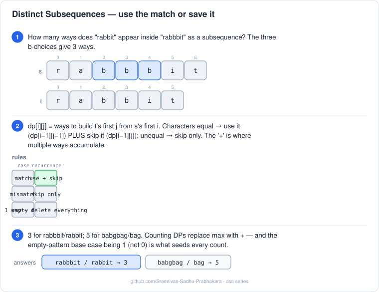

# Distinct Subsequences

> NeetCode 150 · 2-D DP — count the ways s can spell t: on a character match, use it or skip it, and a right-to-left row sweep enforces single use. Go, stdlib only, tested.

## Problem

How many distinct subsequences of s equal t? "rabbbit" spells "rabbit" 3 ways (choose which two of the three b's). Counting, not existence — subtler than it looks.

## Approach

`dp[j]` = ways to spell t's first j characters using the prefix of s processed so far, seeded `dp[0] = 1` (empty target, take nothing). Each s-character that matches t's j-th adds `dp[j−1]` ways (use it) to the existing `dp[j]` (skip it). The **right-to-left** sweep over j is the 0/1-knapsack discipline (dsa-173) transplanted to strings: left-to-right would let one s-character stand for several consecutive t-positions. The classic table version is O(n·m) space; this row is the standard collapse. Counts grow fast — binomials — which is why the answer is an int and not a bool.

**Complexity:** O(n·m) time, O(m) space.

## Visual walkthrough

Read the picture top to bottom — each numbered frame is one moment of the algorithm
running on this repo's test example.

## Run

    go test ./...   # verify
    go run .        # demo

---

Part of a 275-repo DSA series in Go — Striver's SDE Sheet (dsa-001–191) plus the NeetCode 150 / Blind 75 additions (dsa-192–275), stdlib only, every solution tested. Browse: [`dsa-*` repos](https://github.com/Sreenivas-Sadhu-Prabhakara?tab=repositories&q=dsa-&type=source).
